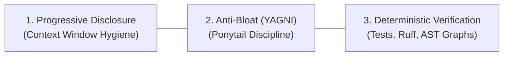
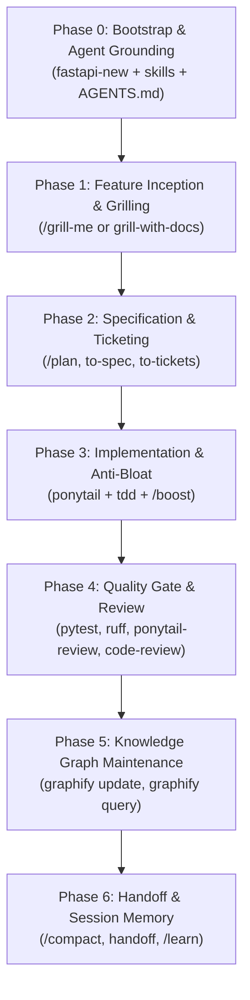

# Production AI & FastAPI Engineering Playbook
### The Definitive Guide to Antigravity 2.0, Skills Orchestration, Anti-Bloat Engineering & Multi-Agent Git Standards

---

## Table of Contents
1. [Core Philosophy & Architecture](#1-core-philosophy--architecture)
2. [Global vs. Project-Specific Customizations](#2-global-vs-project-specific-customizations)
3. [The Complete Tool & Command Roster](#3-the-complete-tool--command-roster)
4. [The 6-Phase Lifecycle Flow](#4-the-6-phase-lifecycle-flow)
   - [Phase 0: Bootstrap & Agent Grounding](#phase-0-bootstrap--agent-grounding)
   - [Phase 1: Feature Inception & Grilling](#phase-1-feature-inception--grilling)
   - [Phase 2: Specification & Ticket Decomposition](#phase-2-specification--ticket-decomposition)
   - [Phase 3: Anti-Bloat, Test-Driven Implementation](#phase-3-anti-bloat-test-driven-implementation)
   - [Phase 4: Quality Gate, Linting & Dual-Axis Review](#phase-4-quality-gate-linting--dual-axis-review)
   - [Phase 5: Knowledge Graph Maintenance & Exploration](#phase-5-knowledge-graph-maintenance--exploration)
   - [Phase 6: Session Management & Handoff](#phase-6-session-management--handoff)
5. [The Slash Command & Skill Coordination Matrix](#5-the-slash-command--skill-coordination-matrix)
6. [Multi-Agent Portability & Team Git Standards](#6-multi-agent-portability--team-git-standards)
7. [Troubleshooting & Common Pitfalls](#7-troubleshooting--common-pitfalls)

---

## 1. Core Philosophy & Architecture

Modern AI-assisted development is not about asking an LLM to generate 1,000 lines of unvetted code in one shot. Doing so leads to hallucinations, speculative over-engineering, dead abstractions, and subtle concurrency bugs in FastAPI backends.

Production AI engineering rests on three non-negotiable principles:



1. **Progressive Disclosure**: Agents should not have their context windows flooded with 5,000 lines of framework rules. Framework guidelines live in on-demand `.agents/skills/`. Project-level instructions in `AGENTS.md` stay lean (under 30 lines).
2. **Anti-Bloat / Ponytail Mode**: LLMs naturally love adding factory classes, repository wrappers, and speculative abstractions. Ponytail discipline enforces: *implement the smallest, cleanest change that completely solves the problem and passes tests.*
3. **Deterministic Verification**: Never trust an LLM's claim that code works. Verify using `uv run pytest`, enforce syntax and linting with `uv run ruff`, and verify architectural dependencies with `graphify`.

---

## 2. Global vs. Project-Specific Customizations

A common trap is installing every tool globally, cluttering the agent's trigger index across all projects.

### The Golden Rule
> **Keep framework, library, and development workflow skills in the Project (`.agents/skills/`).**
> **Keep personal cross-repo utilities in Global (`~/.gemini/config/skills/`).**

```
┌────────────────────────────────────────────────────────┐
│ Global Scope (~/.gemini/config/skills/)               │
│ - Personal automation & reporting (automation, report) │
│ - Agent platform guides (antigravity-guide)            │
│ - Global CLI engines (graphify)                        │
└──────────────────────────┬─────────────────────────────┘
                           │
                           ▼
┌────────────────────────────────────────────────────────┐
│ Project Scope (.agents/skills/ & .agents/rules/)       │
│ - Official library skills (fastapi, typer, pydantic)   │
│ - Engineering lifecycle (to-spec, to-tickets, tdd)     │
│ - Code review & anti-bloat (ponytail, code-review)     │
│ - Project rule steering (.agents/rules/graphify.md)   │
│ - Versioned via Git & skills-lock.json                 │
└────────────────────────────────────────────────────────┘
```

### Why Project-Specific Wins:
1. **Zero Context Contamination**: When opening a React, Go, or Rust repository, your agent won't be weighed down by 15 FastAPI skills.
2. **Deterministic Team Sync**: Your team members (and CI runners) get the exact same agent skills via `skills-lock.json`.
3. **Cross-Agent Standards**: Antigravity, Cursor, Claude Code, Codex, and Windsurf all discover `.agents/skills/`.

---

## 3. The Complete Tool & Command Roster

Here is what each component does and where it comes from:

| Layer | Component | Provider | Scope | Core Responsibility |
| :--- | :--- | :--- | :--- | :--- |
| **Runtime & Deps** | `uv` / `fastapi-new` | Astral / Tiangolo | CLI | Fast Python package management, virtual envs, locks, and FastAPI boilerplate. |
| **Lint & Format** | `ruff` | Astral | CLI | Instant Rust-based Python linter and formatter. |
| **Library Skills** | `library-skills` | Community | Project | Extracts official skills bundled in Python packages (`fastapi`, `typer`) into `.agents/skills/`. |
| **Workflow Skills** | `mattpocock/skills` | Matt Pocock | Project | Software engineering lifecycle: grilling, spec writing, ticketing, TDD, code review, bug diagnosis. |
| **Anti-Bloat** | `ponytail` | Dietrich Gebert | Project | Senior dev guardrail: enforces YAGNI, prevents AI over-engineering, audits dead code. |
| **Knowledge Graph**| `graphify` | Safi Shamsi | Global CLI + Project Rule | Deterministic AST + semantic codebase graph (`graph.json`, `graph.html`, `GRAPH_REPORT.md`). |
| **Agent Engine** | **Antigravity 2.0** | Google DeepMind | IDE / Agent | Native multi-agent orchestration, background execution, artifacts, and slash commands. |

---

## 4. The 6-Phase Lifecycle Flow



---

### Phase 0: Bootstrap & Agent Grounding

Run these commands in an empty directory to establish the production foundation:

```powershell
# 1. Initialize FastAPI project with uv
uvx fastapi-new .

# 2. Add production dev dependencies
uv add --dev ruff pytest httpx

# 3. Reconcile official skills bundled in installed libraries
uvx library-skills install --all --copy -y

# 4. Install curated Matt Pocock engineering skills
npx skills add mattpocock/skills --skill setup-matt-pocock-skills ask-matt grill-with-docs to-spec to-tickets implement tdd code-review diagnosing-bugs handoff --copy -y

# 5. Install Ponytail anti-bloat skills
npx skills add DietrichGebert/ponytail --skill ponytail ponytail-review --copy -y

# 6. Initialize Git & configure .gitignore
git init

# 7. Wire up Graphify rules for Antigravity
graphify antigravity install
```

#### Configure `pyproject.toml`
Ensure `pyproject.toml` contains pytest and ruff settings:
```toml
[tool.pytest.ini_options]
pythonpath = ["."]
testpaths = ["tests"]

[tool.ruff]
line-length = 88
target-version = "py310"

[tool.ruff.lint]
select = ["E", "F", "I", "UP", "B", "SIM"]
```

#### Grounding Prompt (Sent to Antigravity)
> *"Run `/setup-matt-pocock-skills`. For our issue tracker, configure **Local markdown** under `.scratch/`. Then generate a concise, 15-line `AGENTS.md` specifying `uv run fastapi dev`, `uv run pytest`, `uv run ruff check . --fix`, and referencing our `.agents/skills/`. Do not write application code yet."*

---

### Phase 1: Feature Inception & Grilling

Never let the agent write code immediately after a feature prompt. Force it to interview you on edge cases, schemas, and failure modes.

#### Coordination:
- **Fast stress-test**: Use built-in `/grill-me`.
- **Architectural decisions**: Use `grill-with-docs` (automatically creates ADRs in `docs/adr/` and terms in `GLOSSARY.md`).

#### Example Prompt:
> *"I want to create an endpoint that accepts a prompt, streams an LLM completion using HTTP Server-Sent Events, and validates a Bearer API token via FastAPI dependency injection. `/grill-me` on auth failure handling, timeout behavior, and streaming error propagation."*

#### What Happens:
The agent will challenge your assumptions:
* *What happens if the upstream LLM provider times out mid-stream?*
* *How is the Bearer token validated (hardcoded secret vs environment variable vs database lookup)?*
* *Should token exhaustion return 429 or 503?*

---

### Phase 2: Specification & Ticket Decomposition

Once the grilling resolves all ambiguities, turn the discussion into a formal specification and concrete, testable tickets.

#### Coordination:
- Use `to-spec` to generate `specs/<feature-name>.md`.
- Use `to-tickets` to break the spec into tracer-bullet tickets in `.scratch/<feature-name>/`.

#### Example Prompt:
> *"Run `to-spec` to document our agreed design. Then run `to-tickets` to split this feature into small, sequential tickets with explicit acceptance tests."*

#### Output:
The agent creates:
- `.scratch/llm-auth-stream/01-auth-dependency.md` (Acceptance criteria: 401 on invalid token, 200 on valid token).
- `.scratch/llm-auth-stream/02-streaming-route.md` (Acceptance criteria: returns `EventSourceResponse`, handles LLM stream chunks).
- `.scratch/llm-auth-stream/03-error-boundary.md` (Acceptance criteria: catches upstream client timeouts gracefully).

---

### Phase 3: Anti-Bloat, Test-Driven Implementation

Implement one ticket at a time. Enforce TDD (tests first) and Ponytail (minimal code).

#### Coordination:
- Pair `tdd` with `ponytail`.
- If the feature requires deep architectural coordination across multiple files, trigger `/boost`.

#### Example Prompt:
> *"Let's implement Ticket 01 (`01-auth-dependency.md`). Follow `tdd`: write the failing test in `tests/test_auth.py` first. Then, in `ponytail` mode, implement the simplest FastAPI security dependency that passes the test. No unnecessary wrapper classes or factory patterns."*

#### Execution Cycle:
1. Agent creates `tests/test_auth.py` using `httpx.AsyncClient` or `TestClient`.
2. Agent runs `uv run pytest` -> **Fails (Red)**.
3. Agent implements `Annotated[str, Depends(oauth2_scheme)]` in `main.py` -> **Passes (Green)**.
4. Agent runs `uv run ruff check . --fix` and `uv run ruff format .` -> **Clean (Refactor)**.

---

### Phase 4: Quality Gate, Linting & Dual-Axis Review

Before considering any ticket complete, run the verification gates.

#### Coordination:
- Run `uv run pytest` and `uv run ruff check .`.
- Trigger `ponytail-review` to detect AI-generated bloat or unneeded abstractions.
- Trigger `code-review` for dual-agent verification (one subagent audits repo standards; one subagent audits spec compliance).
- If anything fails unexpectedly, invoke `diagnosing-bugs`.

#### Example Prompt:
> *"Ticket 01 is implemented. Run `uv run pytest` and `uv run ruff check .`. If clean, run `ponytail-review` on git diff to verify no bloat was introduced."*

---

### Phase 5: Knowledge Graph Maintenance & Exploration

Keep your codebase graph updated so you can query architecture and relationships effortlessly.

#### Coordination:
- Run `graphify update .` whenever code files change (AST extraction: instant, deterministic, zero LLM cost).
- Query relationships using `graphify query "<question>"`.

#### Example Usage:
```powershell
# Re-extract AST graph after adding routes
graphify update .

# Query the codebase
graphify query "Where is the auth dependency injected into routes?"
graphify path "auth_dependency" "stream_endpoint"
```

In Antigravity chat, simply ask:
> *"Using graphify, show me every route that depends on our authentication scheme."*
Because `.agents/rules/graphify.md` is installed, Antigravity automatically queries `graphify-out/graph.json` before answering.

---

### Phase 6: Session Management & Handoff

When completing a milestone or ending a coding session:

#### Coordination:
- Use `/compact` mid-conversation when the chat gets sluggish to compress context tokens.
- Use `handoff` at the end of the day or when switching tasks.
- Use `/learn` if the agent made a mistake that you want it to never repeat.

#### Example Prompt:
> *"Run `handoff`. Summarize what we completed (Tickets 01 and 02), what is pending (Ticket 03), and the state of our pytest suite into `.scratch/handoff.md`."*

---

## 5. The Slash Command & Skill Coordination Matrix

| Situation / Task | Slash Command / Skill Combination | What Happens |
| :--- | :--- | :--- |
| **Starting a new project** | `setup-matt-pocock-skills` | Asks issue tracker preferences, creates `docs/agents/`, updates `AGENTS.md`. |
| **New feature brainstorming** | `/grill-me` + `grill-with-docs` | Relentless interview, exposes edge cases, writes ADR and glossary. |
| **Breaking down a plan** | `to-spec` -> `to-tickets` | Converts interview into spec and tickets with blocking links in `.scratch/`. |
| **Writing code** | `tdd` + `ponytail` | Red-Green-Refactor test cycle with minimal, YAGNI implementation. |
| **Complex / intricate refactoring**| `/boost` | Deep-thinking multi-agent orchestrator for architectural overhauls. |
| **Parallel file modifications** | `/teamwork` | Spawns multiple subagents to edit disparate files concurrently. |
| **Reviewing recent code** | `ponytail-review` + `code-review` | Inspects diff for AI bloat and tests compliance against ticket specs. |
| **Test or runtime failure** | `diagnosing-bugs` | Structured diagnosis loop to locate root causes instead of guessing. |
| **Exploring architecture** | `graphify query "<question>"` | Traverses AST knowledge graph for instant relationship mapping. |
| **Long chat / token exhaustion** | `/compact` | Compresses previous turns to free up context window. |
| **Session wrap-up** | `handoff` | Generates a clean markdown briefing for the next session or collaborator. |
| **Correcting agent behavior** | `/learn` | Persists the correction into a permanent rule or skill. |

---

## 6. Multi-Agent Portability & Team Git Standards

If you collaborate with developers using **Cursor**, **Claude Code**, **Windsurf**, or **Copilot**, your project remains 100% interoperable.

### 1. The Vendor-Neutral Standard: `AGENTS.md`
`AGENTS.md` at repository root is supported out-of-the-box by Antigravity, Cursor, Claude Code, Windsurf, Codex, and Aider.

```markdown
# Project AI Agent Instructions

## Overview
FastAPI backend for LLM inference, managed with `uv`.

## Standard Commands
- Dev Server: `uv run fastapi dev`
- Tests: `uv run pytest`
- Lint & Format: `uv run ruff check . --fix` and `uv run ruff format .`
- Sync Dependencies: `uv sync`
- Restore Skills: `npx skills experimental_install`

## Architecture & Code Guidelines
- Follow YAGNI (Ponytail): Smallest working implementation; no premature factories or wrapper layers.
- Consult `.agents/skills/` for FastAPI and engineering runbooks.
```

### 2. Lockfiles to Commit
* `uv.lock`: Guarantees exact Python dependency versions.
* `skills-lock.json`: Guarantees exact agent skills versions across machines.

### 3. Collaborator Setup Commands
When another developer clones the repository:
```powershell
# 1. Install exact Python environment
uv sync

# 2. Restore all project skills
npx skills experimental_install

# 3. Run test suite to verify
uv run pytest
```

---

## 7. Troubleshooting & Common Pitfalls

### Pitfall 1: Manual Duplication in `AGENTS.md`
* **Mistake**: Writing 200 lines in `AGENTS.md` explaining how to use `Annotated`, Pydantic, and async FastAPI.
* **Fix**: Delete it. That knowledge is already maintained inside `.agents/skills/fastapi/SKILL.md`. Keep `AGENTS.md` under 30 lines.

### Pitfall 2: Windows Symlink Failures
* **Mistake**: Running `npx skills add` or `library-skills install` without `--copy`. On Windows, git or filesystems without developer mode can break symlinks.
* **Fix**: Always include `--copy`:
  ```powershell
  uvx library-skills install --all --copy -y
  npx skills add ... --copy -y
  ```

### Pitfall 3: Installing All 38 Matt Pocock Skills
* **Mistake**: Installing the entire mattpocock repository. This injects 38 skill descriptions into the agent's context index on every prompt, degrading attention.
* **Fix**: Only install the core engineering set: `ask-matt`, `setup-matt-pocock-skills`, `grill-with-docs`, `to-spec`, `to-tickets`, `implement`, `tdd`, `code-review`, `diagnosing-bugs`, and `handoff`.

### Pitfall 4: Trusting Agent Claims Without Verification
* **Mistake**: Letting the agent say *"I've implemented the endpoint and it works perfectly."*
* **Fix**: The definition of done is `uv run pytest` passing and `uv run ruff check .` passing.
